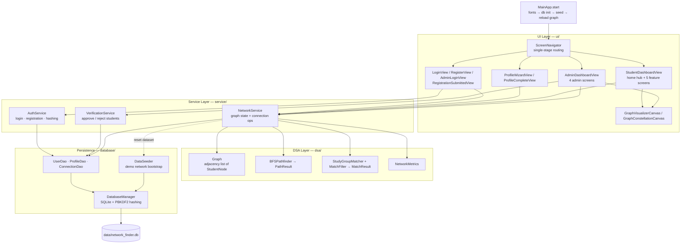
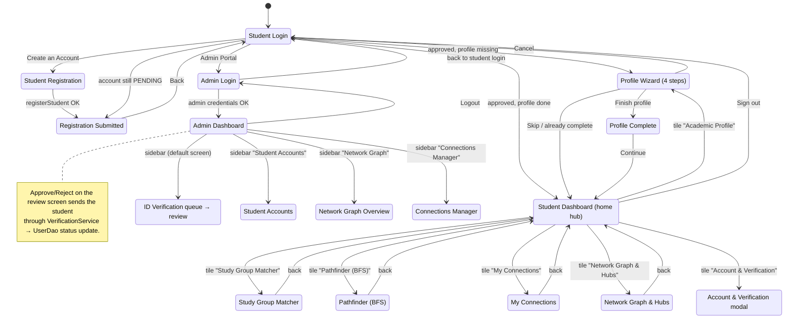
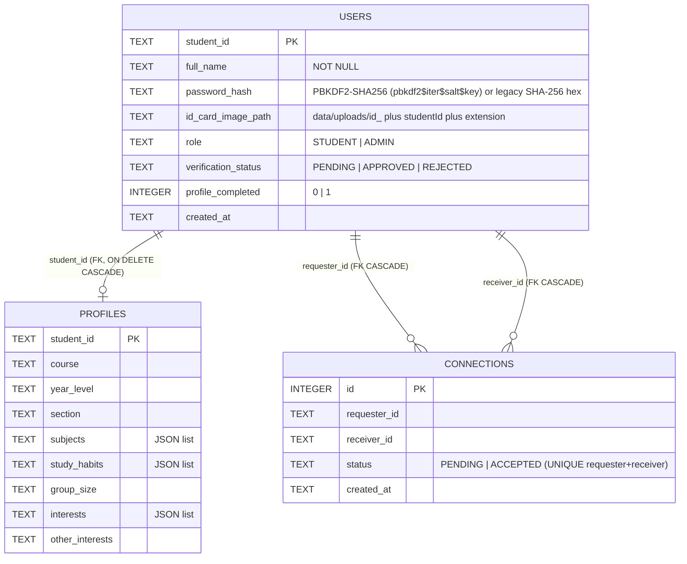
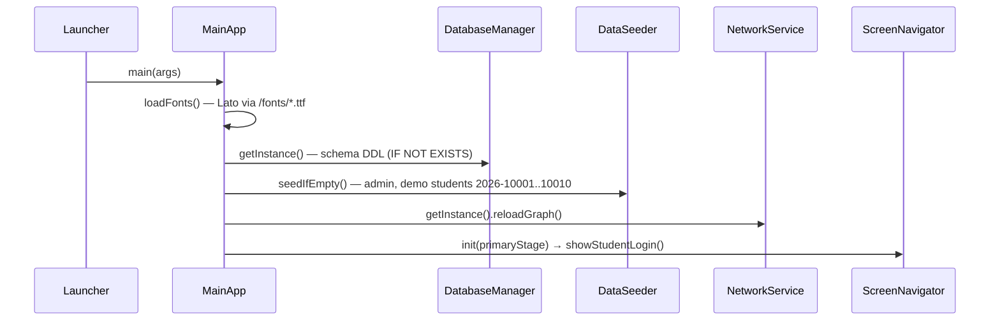
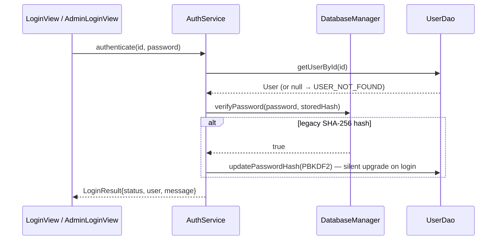
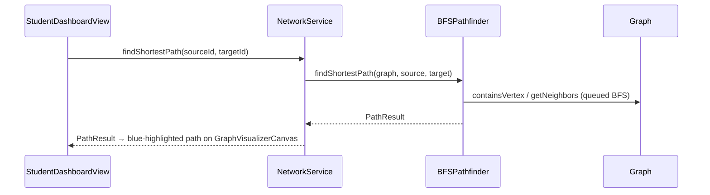
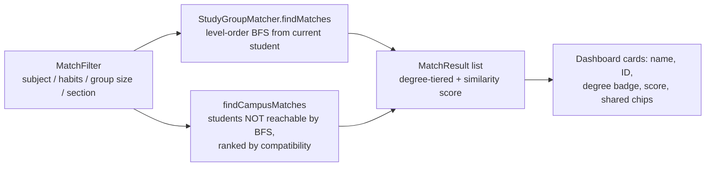
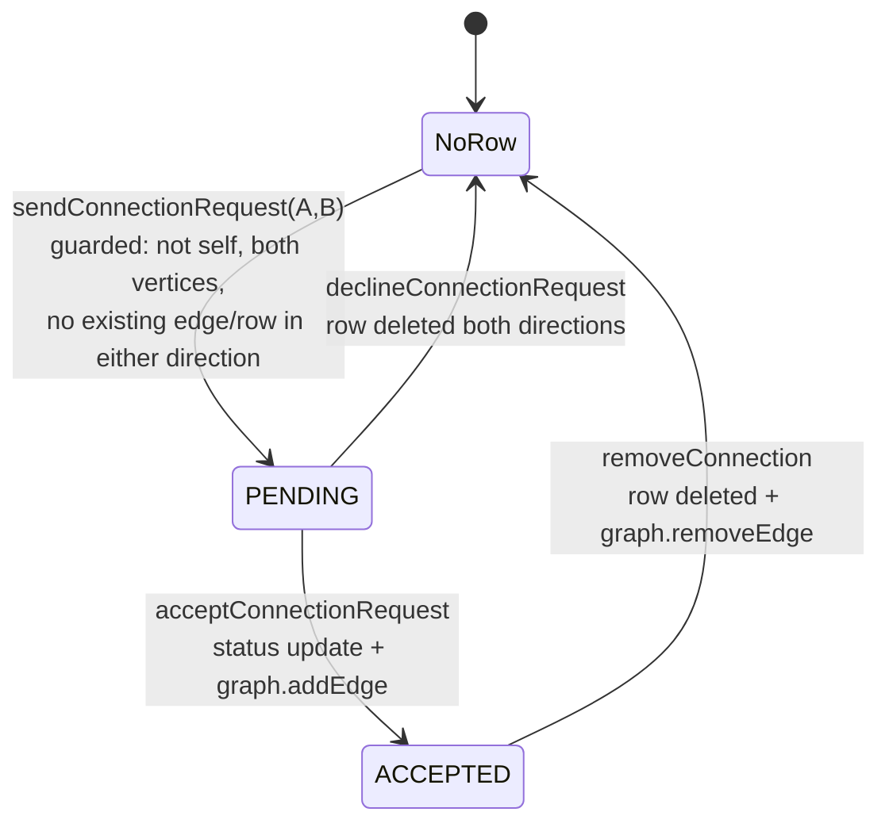

# NetworkConnectionFinder — Application Structure & Flow

A single-window JavaFX desktop app implementing a **student social network** on top of classic
**Data Structures & Algorithms**: an adjacency-list undirected **Graph**, **BFS** shortest-path
("degrees of separation"), level-order **study-group matching**, and **degree centrality** metrics.
Persistence is a local **SQLite** database behind a small DAO layer.

---

## 1. System Overview (layered)

- **Services are the only seam** between UI and logic/persistence: every view reaches data
  through a service. `NetworkService` doubles as a **read facade** (`getStudentProfile`,
  `getAllUsers`, `getAllProfiles`) so views never construct DAOs.
- **Mutations return `OperationResult`** (`ok` flag + human-readable `message`), so UIs surface
  the exact service reason instead of guessing (inline labels, alerts or dialog failures).
- **NetworkService** is a synchronized singleton that owns the in-memory `Graph` and keeps it
  consistent with the database via `reloadGraph()`.

---

## 2. Component Map

| Package | Class | Responsibility |
|---|---|---|
| `com.networkfinder` | `Launcher` | Entry point shim (`MainApp.main`) |
| | `MainApp` | JavaFX `Application`: loads Lato fonts, boots DB, seeds, reloads graph, shows login |
| `ui` | `ScreenNavigator` | Holds primary `Stage` + `currentUser`; every screen swap goes through it |
| | `LoginView` / `AdminLoginView` | Student & admin sign-in (show/hide password, role routing) |
| | `RegisterView` | Registration form with ID-card image upload → `AuthService.registerStudent` |
| | `RegistrationSubmittedView` | "Submitted, pending verification" confirmation |
| | `ProfileWizardView` | 4-step academic profile wizard (subjects, habits, group size, interests) |
| | `ProfileCompleteView` | Profile summary → continues to dashboard |
| | `StudentDashboardView` | Windows-Settings-style hub: Matcher, Pathfinder, Connections, Analytics, Account modal, logout |
| | `AdminDashboardView` | Sidebar: ID Verification, Student Accounts, Network Graph, Connections Manager |
| | `GraphVisualizerCanvas` | Circular graph layout, path highlighting, node click + tooltips |
| | `GraphConstellationCanvas` | Animated decorative constellation (login/registration hero panel) |
| `service` | `AuthService` | `authenticate` (PBKDF2 verify + legacy-hash upgrade), `registerStudent` (validation, sanitized 5 MB-capped ID upload) |
| | `VerificationService` | Pending list; approve/reject students → `OperationResult` |
| | `NetworkService` | Owns `Graph`; shortest-path/matcher/metrics façade; read facade (`getStudentProfile`, `getAllUsers`, `getAllProfiles`); `OperationResult` connection lifecycle + profile save + admin student/edge management |
| | `OperationResult` | Immutable mutation outcome: `ok()` flag + human-readable `getMessage()` consumed directly by UIs |
| `dsa` | `Graph` | `HashMap<id, StudentNode>` + `HashMap<id, LinkedHashSet<id>>` adjacency list (thread-safe, snapshot reads) |
| | `StudentNode` | Vertex: studentId, fullName, `StudentProfile` |
| | `BFSPathfinder` | BFS shortest path → `PathResult` (path, degrees of separation, nodes explored) |
| | `StudyGroupMatcher` | Level-order BFS matches + campus-wide matching for disconnected peers → `MatchResult` |
| | `MatchFilter` | Required subject/habit/group size, same-section-only, max BFS degree |
| | `NetworkMetrics` | Mutual connections (adjacency intersection), degree centrality `deg/(N-1)`, top coordinators |
| `database` | `DatabaseManager` | SQLite singleton: schema init, per-connection FK/busy-timeout pragmas, PBKDF2 hash/verify |
| | `DataSeeder` | `seedIfEmpty()` (admin + 10-student demo network), transactional `forceResetAndSeed()` |
| | `UserDao` | users CRUD, pending/approved queries, status/name/password updates |
| | `ProfileDao` | profiles upsert/lookup, list fields stored as JSON (Gson) |
| | `ConnectionDao` | connection rows upsert/find/remove, accepted pairs, pending in/out requests |
| `model` | `User`, `Role`, `VerificationStatus` | Account model + enums (STUDENT/ADMIN, PENDING/APPROVED/REJECTED) |
| | `StudentProfile` | Course, year, section, subjects, study habits, group size, interests |
| | `Connection`, `ConnectionStatus` | Edge record + PENDING/ACCEPTED |

---

## 3. Screen Navigation Flow

Login routing rules (`LoginView`):

| `AuthStatus` | Result |
|---|---|
| `SUCCESS` + ADMIN | Admin Dashboard |
| `SUCCESS` + STUDENT, `profileCompleted` and profile row exists | Student Dashboard |
| `SUCCESS` + STUDENT, otherwise | Profile Wizard |
| `PENDING_VERIFICATION` | Registration Submitted screen |
| `INVALID_CREDENTIALS` / `USER_NOT_FOUND` / `ACCOUNT_REJECTED` | inline error message |

---

## 4. Data Model (SQLite, `data/network_finder.db`)

- **`networkfinder.db.path` system property** redirects the DB file (tests use a temp copy —
  the test suite never touches the developer's real database).
- Every connection opens with `PRAGMA foreign_keys = ON` and `busy_timeout = 5000`, so the
  cascades on this diagram are enforced at runtime.
- A connection pair is **undirected at graph level**: `(A→B ACCEPTED)` ↔ `A—B` edge. Requests
  are stored directionally (`requester → receiver`) while `PENDING`.

---

## 5. Key Runtime Flows

### 5.1 Startup

`reloadGraph()` rebuilds the in-memory graph: profiles are loaded with **one** `getAllProfiles()`
query and indexed by `student_id`, `getApprovedStudents()` become `StudentNode` vertices (falling
back to an empty profile), then `getAcceptedPairs()` become edges. It is re-run after admin resets
and mutates so the graph never disagrees with the DB.

### 5.2 Authentication

### 5.3 Registration

`RegisterView` (validation: ID charset, ≥8 chars, password match, ID photo upload)
→ `AuthService.registerStudent` → sanitized copy to `data/uploads/`, PBKDF2 hash,
`UserDao.createUser` as `STUDENT / PENDING` → `RegistrationSubmittedView` → admin approves in
the verification queue (`VerificationService.approveStudent` → status `APPROVED`).

### 5.4 Pathfinder (BFS)

Degrees of separation = path length − 1; shortest hops guaranteed because BFS explores level
by level.

### 5.5 Study Group Matching

Compatibility score: `+25/common subject`, `+15/common habit`, `+20 same section`,
`+15 same course`, `+15 same group size`.

### 5.6 Connection Request Lifecycle

PENDING rows never touch the graph — `NetworkService.hasConnection`/`getAcceptedPairs` only
promote `ACCEPTED` rows into edges. Every lifecycle method above returns a reason-coded
`OperationResult`: guards fail with exact causes ("You are already connected to X.", "An active
link or pending request with X already exists.", …) and the views show that message verbatim
(inline labels on the Connections screen, warning alerts elsewhere).

### 5.7 Admin Operations

| Operation | Code path | Notes |
|---|---|---|
| List pending verifications | `AdminDashboardView → VerificationService → UserDao.getPendingStudents` | review screen shows ID photo from `data/uploads/` |
| Approve / reject | `VerificationService.approveStudent / rejectStudent` → `OperationResult` | on approve: `reloadGraph()` runs immediately so the student becomes a graph vertex |
| Add student | `adminAddStudent` | valid-ID/validation-failures return reason-coded failures; success creates APPROVED user (+ default password `password123`, PBKDF2) and profile, adds vertex; admin dialogs surface the reason verbatim |
| Edit student | `adminEditStudent` | updates user row + profile + live graph node |
| Delete student | `adminDeleteStudent` | deletes user, purges incident connection rows, deletes profile, removes vertex |
| Add / remove edge | `addConnection` / `removeConnection` | validated: distinct vertices, no duplicate/reverse edge |
| Reset dataset | `adminResetDataset → DataSeeder.forceResetAndSeed` | one transaction wipes tables, re-seeds 10 students / 11 edges |

---

## 6. Verification & Tooling

- `mvnw.cmd test` — 4 unit test classes (Graph, BFSPathfinder, NetworkMetrics, StudyGroupMatcher)
  plus `ServiceIntegrationTest` on an isolated temp DB (`networkfinder.db.path`).
- `mvnw.cmd javafx:run` — launches the application for manual UI exploration.
- The wrapper self-bootstraps Apache Maven 3.9.9 into `.tools\` on first use.
