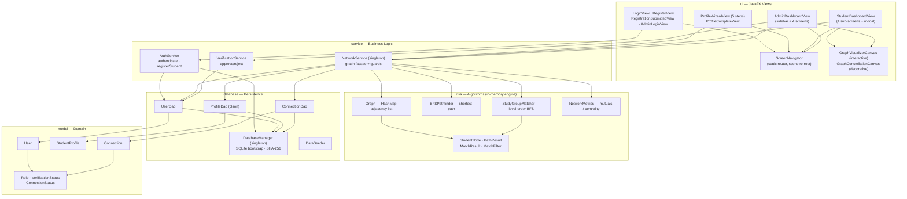
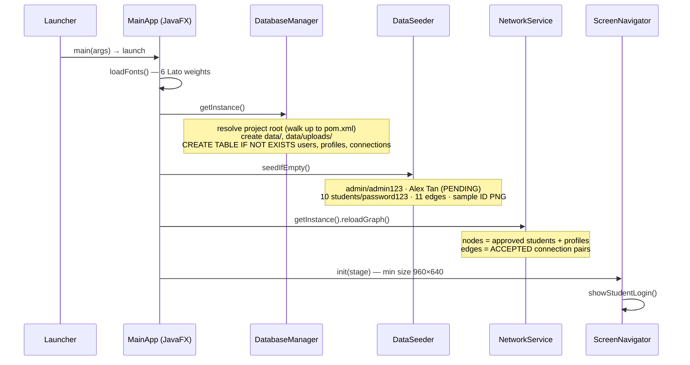
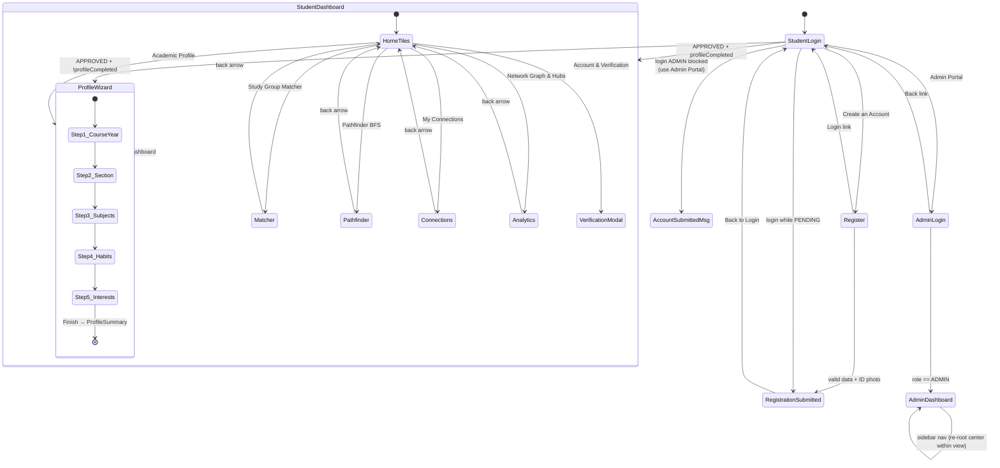
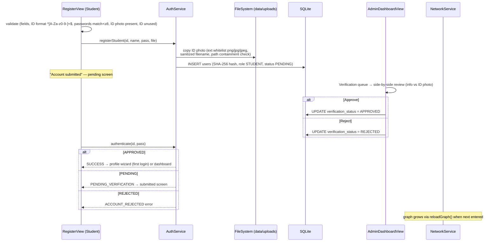
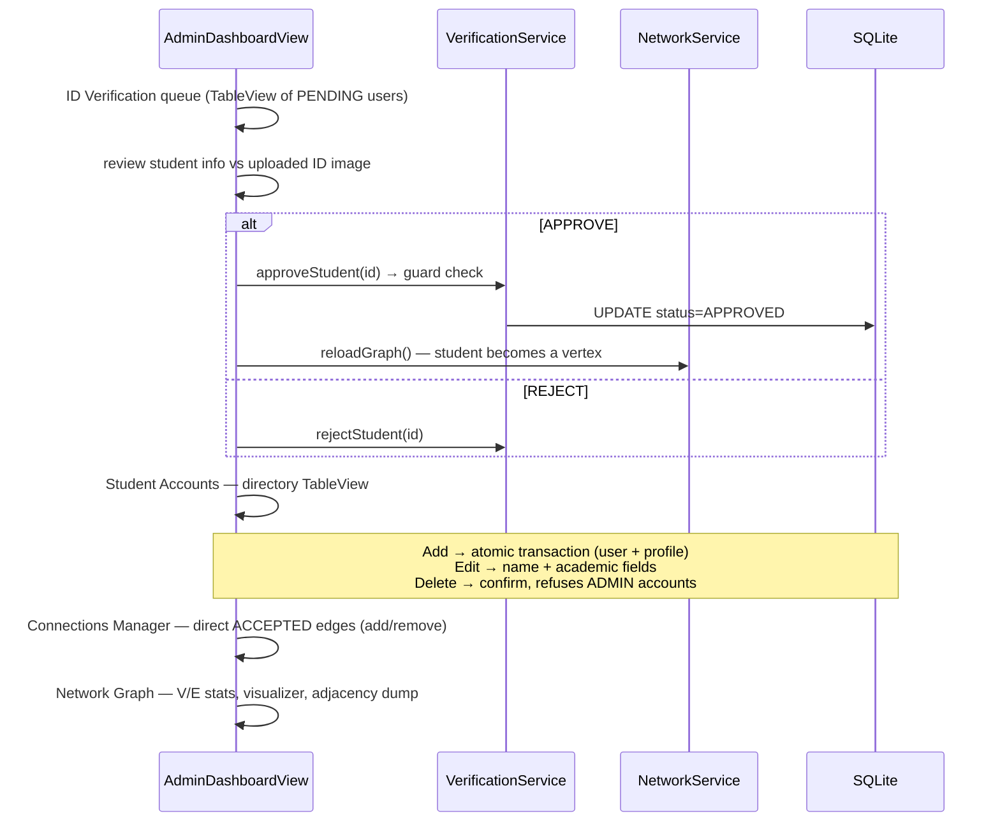
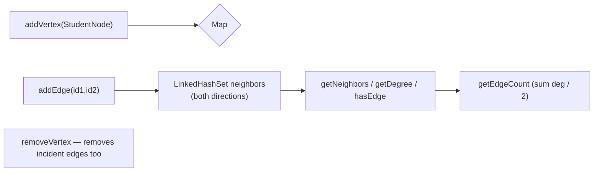
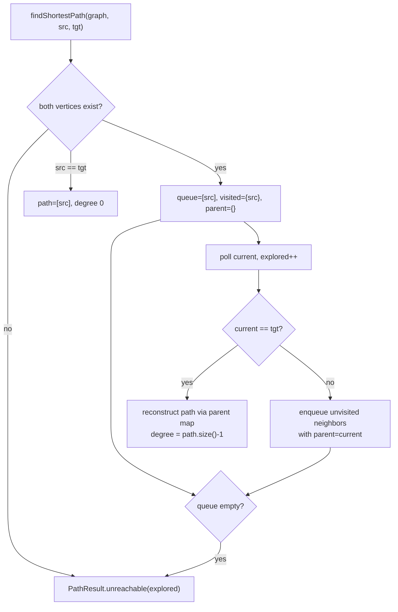
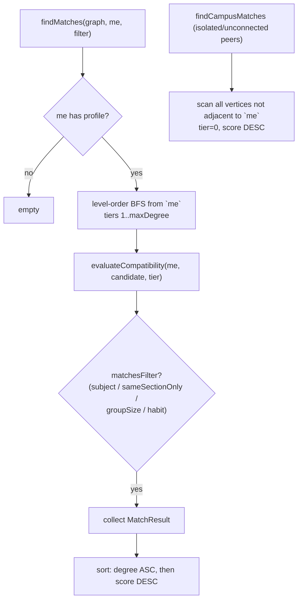
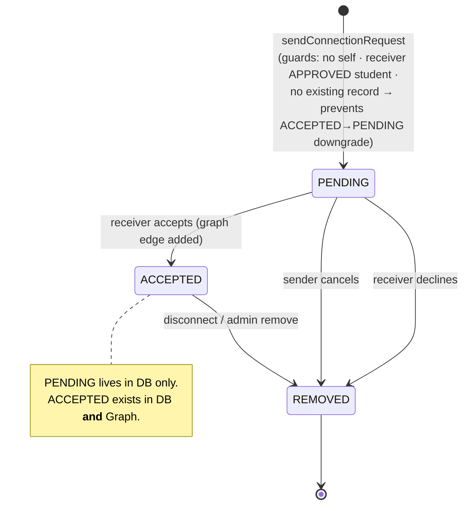
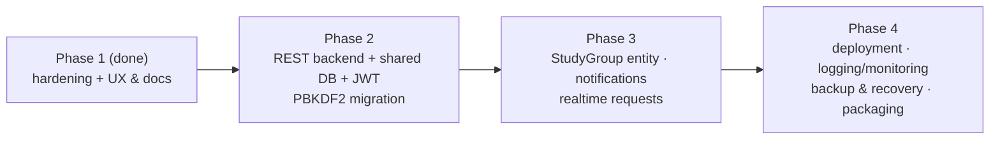

# Social Network Connection Finder — Structure Flow & System Audit

> Academic & Study Group Matchmaker (DSA). Java 21 · JavaFX 21 · Maven · SQLite · Gson · JUnit 5.
> Run: `run_app.bat` (executes `mvnw.cmd javafx:run`). Entry: `Launcher` → `MainApp`.
> This document reflects the system **after the hardening/UX pass** (see §12–§13).

---

## 1. Tech Stack

| Layer | Technology | Notes |
|---|---|---|
| UI | JavaFX (code-built views, no FXML screens) | Fluent-dark CSS theme, `styles.css` |
| Styling | CSS custom look-up colors (`-fx-ink`, `-fx-accent`, …) | Resource: `src/main/resources/css/styles.css` |
| Fonts | Lato (6 weights) loaded at startup | `src/main/resources/fonts/` |
| Persistence | SQLite via xerial JDBC, file-per-project under `data/` | `data/network_finder.db`, uploads in `data/uploads/` |
| JSON | Gson | Lists inside `profiles` stored as JSON strings |
| Build | Maven wrapper, JavaFX Maven plugin (`javafx:run`) | Java 21 |
| Tests | JUnit 5 (4 DSA suites + 1 service integration suite) | `mvnw test` |

---

## 2. Layer Architecture



Key idea: **two identities per student** — `User`/`StudentProfile` (persistent, DB-backed) and `StudentNode` (in-memory graph vertex keyed by `studentId`, holds a copy of the profile). `NetworkService.reloadGraph()` rebuilds nodes+edges from approved users and ACCEPTED connections.

---

## 3. Application Startup Flow



---

## 4. Screen Navigation Map

`ScreenNavigator` keeps one `Scene` (initially 1020×720) and re-roots it per screen.



Admin sidebar: `ID Verification` (queue → side-by-side review) · `Student Accounts` (CRUD dialogs) · `Network Graph` (stats + canvas + adjacency dump) · `Connections Manager` (direct edges) · **Logout pinned at sidebar bottom**.

---

## 5. Student Flows

### 5.1 Registration → Verification → Login



Login outcome matrix (student portal):

| Credential state | Result |
|---|---|
| Unknown ID **or** wrong password | generic `Invalid Student ID or password.` (enumeration-safe, constant-time compare) |
| `PENDING` | Submitted-account screen |
| `REJECTED` | Rejected error |
| `APPROVED` + profile complete | Student Dashboard |
| `APPROVED` + profile incomplete | Profile Wizard |
| `ADMIN` (any password match) | **Blocked** — must use Admin Portal |

### 5.2 First-login Profile Wizard (5 steps)

Course/Year → Section (required) → Subjects (min 2) → Study habits + group size → Interests (+optional other) →
`ProfileDao.saveOrUpdateProfile` + `UserDao.updateProfileCompleted(true)` + `NetworkService.reloadGraph()` → Profile summary → Dashboard.

---

## 6. Admin Flows



---

## 7. DSA Core — Algorithm Flows

### 7.1 Graph (adjacency list)



**Complexity:** O(1) insert/lookup; O(deg) neighbor ops; `synchronized` for mutation safety.

### 7.2 BFSPathfinder (shortest path = degrees of separation)



**Guarantees:** minimum hops in an unweighted graph; returns `NodesExplored` as an observable metric. O(V+E) time.

### 7.3 StudyGroupMatcher (level-order BFS)



**Compatibility scoring (`evaluateCompatibility`)**

| Signal | Points |
|---|---|
| per common subject | +25 |
| per common study habit | +15 |
| same section | +20 |
| same course | +15 |
| same group-size preference | +15 |

Tier labels: 0 = Campus Peer, 1 = Direct Connection, 2 = Friend of Friend, 3+ = nth Degree.

### 7.4 NetworkMetrics

| Metric | Definition | Source |
|---|---|---|
| Mutual connections | Adj(u) ∩ Adj(v) | set intersection |
| Degree centrality | deg(v) / (N−1) | normalized degree |
| Top coordinators | sort all vertices by degree DESC, take limit | hub discovery |

---

## 8. Connection Request Lifecycle



`sendConnectionRequest` returns `false` (UI shows a themed error) when the pair already has any record, a user is missing, the target is not an APPROVED student, or the pair is identical. Duplicate directional rows are prevented by `UNIQUE(requester_id, receiver_id)`.

---

## 9. Database Schema

```mermaid
erDiagram
    USERS ||--o| PROFILES : "1:1 cascade"
    USERS ||--o{ CONNECTIONS : "outgoing (requester)"
    USERS ||--o{ CONNECTIONS : "incoming (receiver)"

    USERS {
        TEXT student_id PK
        TEXT full_name
        TEXT password_hash "SHA-256 (demo plan)"
        TEXT id_card_image_path
        TEXT role "STUDENT | ADMIN"
        TEXT verification_status "PENDING | APPROVED | REJECTED"
        INTEGER profile_completed
        TEXT created_at
    }
    PROFILES {
        TEXT student_id PK_FK
        TEXT course
        TEXT year_level
        TEXT section
        TEXT subjects "JSON list via Gson"
        TEXT study_habits "JSON list"
        TEXT group_size
        TEXT interests "JSON list"
        TEXT other_interests
    }
    CONNECTIONS {
        INTEGER id PK
        TEXT requester_id FK
        TEXT receiver_id FK
        TEXT status "PENDING | ACCEPTED | REJECTED"
        TEXT created_at
    }
```

Constraints: `connections` UNIQUE(requester_id, receiver_id); both user FKs `ON DELETE CASCADE`. `DataSeeder.forceResetAndSeed()` (admin reset path) wipes all tables under `PRAGMA foreign_keys = OFF` and re-seeds.

---

## 10. Seeded Data & Test Accounts

| Account | Password | Role / Status | Purpose |
|---|---|---|---|
| `admin` | `admin123` | ADMIN, APPROVED | Admin portal + verification queue |
| `2026-99999` (Alex Tan) | `student123` | STUDENT, **PENDING** | Demo pending-verification card (ID image auto-generated) |
| `2026-10001` … `2026-10010` | `password123` | STUDENT, APPROVED + full profiles | 10-student benchmark network with 11 edges (friendly names incl. Juan Dela Cruz, Maria Santos, …) |

Demo password constant is centralized: `DatabaseManager.DEFAULT_DEMO_PASSWORD`.

---

## 11. File Tree Appendix

```text
src/main/java/com/networkfinder/
├── Launcher.java           # sun-mitigation entry → MainApp
├── MainApp.java            # fonts → DB init → seed → graph reload → nav
├── ui/
│   ├── ScreenNavigator.java        # static router + scene management + min size
│   ├── LoginView.java              # student sign-in (admins blocked here)
│   ├── RegisterView.java           # + ID/password validation, upload picker
│   ├── RegistrationSubmittedView.java
│   ├── AdminLoginView.java         # no credential hints
│   ├── AdminDashboardView.java     # BorderPane sidebar (logout pinned) + ScrollPane center
│   ├── StudentDashboardView.java   # tiles hub + 4 sub-screens + verification modal
│   ├── ProfileWizardView.java      # 5 steps, CSS-driven chips/cards
│   ├── ProfileCompleteView.java
│   ├── GraphVisualizerCanvas.java  # circular layout, click-to-select, path highlight
│   ├── GraphConstellationCanvas.java # decorative hero art (login screens)
│   └── UiDialogs.java              # dark-theme Alert styling + showError
├── service/
│   ├── AuthService.java            # generic login failure, constant-time compare, upload hygiene
│   ├── NetworkService.java         # guarded connections, atomic admin add, graph facade
│   └── VerificationService.java
├── dsa/
│   ├── Graph.java                  # synchronized adjacency list
│   ├── BFSPathfinder.java
│   ├── StudyGroupMatcher.java
│   ├── NetworkMetrics.java
│   └── StudentNode / PathResult / MatchResult / MatchFilter
├── database/
│   ├── DatabaseManager.java        # singleton, schema DDL, SHA-256, DEFAULT_DEMO_PASSWORD
│   ├── UserDao.java                # + Connection-accepting overload (transactions)
│   ├── ProfileDao.java             # Gson list serialization
│   ├── ConnectionDao.java
│   └── DataSeeder.java
└── model/
    ├── User.java · StudentProfile.java · Connection.java
    └── Role.java · VerificationStatus.java · ConnectionStatus.java

src/main/resources/
├── css/styles.css        # full Fluent-dark theme + .dialog-pane dark section
└── fonts/Lato-*.ttf

src/test/java/com/networkfinder/
├── dsa/GraphTest · BFSPathfinderTest · StudyGroupMatcherTest · NetworkMetricsTest
└── service/ServiceIntegrationTest   # end-to-end service behaviors (must stay green)
```

---

## 12. Security Audit (state after hardening pass)

| # | Finding | Resolution |
|---|---|---|
| S1 | Unsalted SHA-256 passwords | **Deferred (demo plan)** — move to PBKDF2WithHmacSHA256/BCrypt + salt before any networked deployment |
| S2 | Credential hints in admin prompts | ✅ Fixed — prompts neutralized |
| S3 | Request could downgrade ACCEPTED→PENDING via upsert | ✅ Fixed — existing record ⇒ request rejected |
| S4 | `addConnection` wrote DB before validating | ✅ Fixed — both ends validated (exists, distinct, APPROVED students) first |
| S5 | User enumeration via distinct login errors | ✅ Fixed — single generic message |
| S6 | Non-constant-time hash comparison | ✅ Fixed — `MessageDigest.isEqual` |
| S7 | ID-photo upload path/extension weaknesses | ✅ Fixed — extension whitelist, sanitized filename, canonical-path containment |
| S8 | No password/ID format rules | ✅ Fixed — ≥8 chars, `^[A-Za-z0-9-]+$` |
| S9 | Duplicated demo-password literals | ✅ Fixed — single constant |
| S10 | Reverse-direction duplicate rows possible | Noted — graph dedupes; normalize if DB grows |
| + | Admin deletable through service | ✅ Fixed — `adminDeleteStudent` refuses ADMIN |
| + | Admin login reachable from student portal | ✅ Fixed — blocked at LoginView |

Known acceptable-for-demo: no rate limiting/lockout, no HTTPS (local), no session tokens (single client process), `e.printStackTrace()` logging.

---

## 13. Engineering Weaknesses Register

| # | Weakness | Status |
|---|---|---|
| E1 | Silent DB failures (DAO `printStackTrace` + `false`, UI ignored results) | ✅ Fixed — all mutating UI actions surface themed error dialogs |
| E2 | Non-atomic multi-step admin-add | ✅ Fixed — single SQLite transaction (user+profile) |
| E3 | Global mutable state (static navigator/singleton, per-view DAOs) | Open — acceptable for course scale; refactor behind interfaces if growing |
| E4 | Fragile typed casts in dashboard tile search | Open — isolate helper if tiles change |
| E5 | Validation only in UI | Open — pairs with E3/Phase 2 (server-side rules) |
| E6 | Magic scoring constants | Open — documented in §7.3, centralize when tuning |
| E7 | No password-change flow | Open — Phase 2/3 candidate |
| E8 | DB location found by walking to `pom.xml` | Open — externalize config when packaging |
| E9 | No CI/lint; 2-line README | Open — this doc significantly closes the documentation gap |

---

## 14. Roadmap — Standalone → Connected “Study Group Finder”

### 14.1 Gap analysis (what a single-PC build lacks for a campus system)

| Gap | Today | Connected target |
|---|---|---|
| Server | logic lives inside the desktop process | REST/WebSocket backend owning auth + DSA engine (Spring Boot/Quarkus); layered `service`/`dsa` code ports with minimal change |
| Database | embedded single-user SQLite | server-side PostgreSQL/MySQL + migrations (Flyway) + backups |
| Auth/session | static in-process user, SHA-256 | HTTPS, sessions/JWT, PBKDF2/BCrypt, password reset, rate limiting |
| Realtime | reload-on-write in one JVM | push notifications & live requests (WebSocket) or polling; concurrency-safe writes |
| Files | local `data/uploads/` | server upload API + object storage + size/type caps |
| Validation | split UI/service | server-side source of truth |
| Ops | `printStackTrace`, no config file | SLF4J + external config (DB URL, port) + packaging + monitoring |

### 14.2 Product gaps for the “Finder” vision

1. **No `StudyGroup` entity** (group, membership, invite/leave, topic) — the core promise.
2. **No notifications** — bell/badges on pending requests & events.
3. **No communication** — group forum/chat/meeting scheduling.
4. **No privacy controls** — profiles visible to all approved students.
5. **No email verification / audit log** — admin actions untracked.

### 14.3 Phased plan



---

*Generated for defense/demo reference. Keep in sync when screens or schemas change.*
